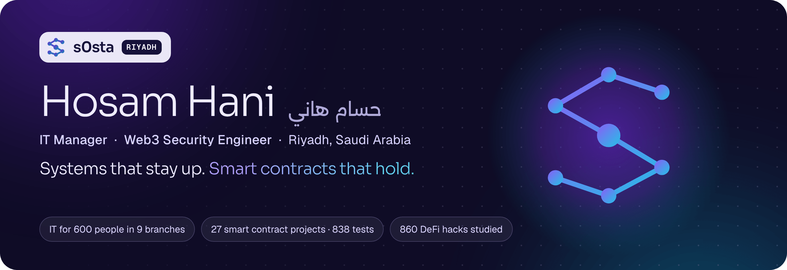
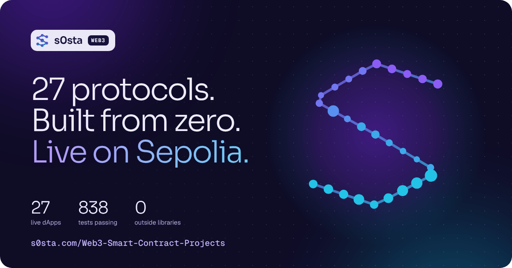
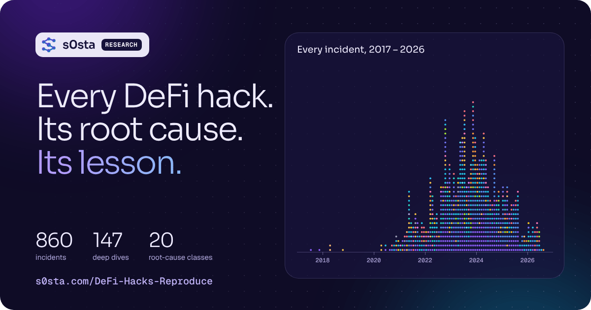
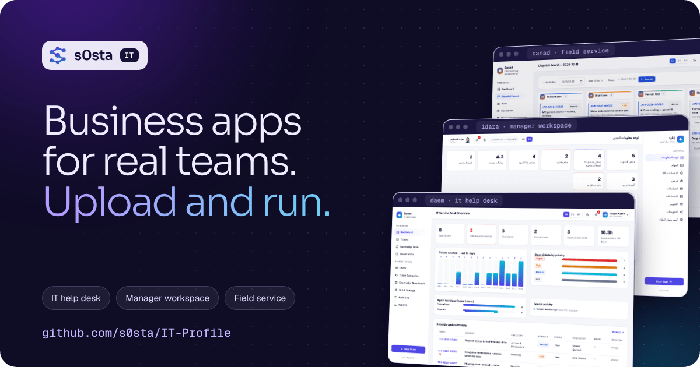

  
  
  
  

## About me

I'm **Hosam Hani**, an **IT Manager** and **Web3 Security Engineer** based in **Riyadh, Saudi Arabia**, with more than four years in IT.

At work, I run the complete IT of a sports-brand distributor with **600 people in 9 branches**. I keep the servers, the network, the ERP and the online store running, and I handle security incidents from the first alert to the final fix.

In Web3, I write **Solidity smart contracts from zero** and test them the way an attacker would. I also study real attacks: my open archive explains **860 DeFi hacks**, each with its root cause and its lesson.

## What I do

<table>
<tr>
<td width="50%" valign="top">

### IT management

- Linux and Windows servers, backups and restore tests
- Networks: LAN and Wi-Fi, VLANs, firewalls, VPN, DNS and SSL
- ERP systems: ERPNext, Odoo and Daftara, from setup to user training
- E-commerce: a bilingual WooCommerce store with about 1,400 products, plus Amazon and Noon
- Security incidents: investigation, cleanup, hardening and prevention

</td>
<td width="50%" valign="top">

### Web3 security

- Smart contract development with Solidity and Foundry
- Testing like an attacker: unit, fuzz and attack tests
- Security reviews: access control, reentrancy, oracles and rounding
- DeFi research: 860 real hacks, their root causes and lessons
- dApp front-ends and deployments on the Sepolia testnet

</td>
</tr>
</table>

## Featured work

<table>
<tr>
<td width="42%" valign="top"></td>
<td valign="top">

### [Web3 Smart Contract Projects](https://github.com/s0sta/Web3-Smart-Contract-Projects)

27 Solidity protocols written from zero, from a simple ERC-20 token to complete platforms for lending, trading, identity and Islamic finance.

`914 tests` · `CI on every push` · `28 live dApps`

**[Live dApps](https://s0sta.com/Web3-Smart-Contract-Projects/)** · **[Code](https://github.com/s0sta/Web3-Smart-Contract-Projects)**

</td>
</tr>
<tr>
<td width="42%" valign="top"></td>
<td valign="top">

### [DeFi Hacks Archive](https://github.com/s0sta/DeFi-Hacks-Reproduce)

860 real DeFi hacks from 2017 to 2026. For each one: the root cause, the attack steps and the lesson. Search by year, chain and bug type.

`860 hacks` · `147 deep dives` · `20 bug types`

**[Website](https://s0sta.com/DeFi-Hacks-Reproduce/)** · **[Code](https://github.com/s0sta/DeFi-Hacks-Reproduce)**

</td>
</tr>
<tr>
<td width="42%" valign="top"></td>
<td valign="top">

### [IT Business Apps](https://github.com/s0sta/IT-Profile)

Three ready-to-use web apps for companies: **Daem** (IT help desk), **Idara** (manager workspace) and **Sanad** (field service). Plain PHP 8, a simple web installer, in English, Deutsch and العربية.

`no frameworks` · `SQLite or MySQL` · `429 test checks`

**[Code](https://github.com/s0sta/IT-Profile)**

</td>
</tr>
</table>

**Websites I build and run:** [babolatksa.com](https://babolatksa.com) (bilingual WooCommerce store) · [here2grow.edu.sa](https://here2grow.edu.sa) (WordPress and SEO for an international school) · [s0sta.com](https://s0sta.com) (self-hosted apps)

## Experience

| Role | Company | Years |
|:--|:--|:--|
| **IT Manager** | Raed Sports · Riyadh, Saudi Arabia | 2025 – today |
| **Freelance IT & Web Developer** | Remote | 2023 – 2025 |
| **IT Support Specialist** | Farma Care Hospital · Cairo, Egypt | 2021 – 2023 |
| **IT Support** | MedCare Hospital · Sharqia, Egypt | 2020 – 2021 |

## Skills and tools

  
  
  
  
  
  
  
  
  
  
  
  
  
  
  
  
  
  
  
  
  

| Area | Skills |
|:--|:--|
| **Servers and hosting** | Linux (Ubuntu, Debian), Windows Server, VPS, Nginx, Apache, cPanel / Plesk, SSH hardening, backups and monitoring |
| **Networking** | LAN / WLAN, routers and switches, VLANs, firewall rules, VPN, DHCP, DNS, SSL / TLS |
| **Business systems** | ERPNext / Frappe, Odoo, Daftara, WordPress, WooCommerce, Amazon and Noon |
| **Security** | Incident response, malware cleanup, system hardening, access control, patching, backup and recovery |
| **Web3** | Solidity, Foundry, EVM, smart contract testing, DeFi attack analysis, ethers.js |
| **Code** | PHP, JavaScript, HTML / CSS, Python, Bash, SQL, Git |

## Certifications

| Certificate | Issuer | Date |
|:--|:--|:--|
| Google IT Support Professional Certificate | Google · Coursera | Feb 2025 |
| Ethical Hacker | Cisco Networking Academy | Nov 2024 |
| Operating Systems Basics | Cisco Networking Academy | Nov 2024 |
| Linux Essentials | Cisco Networking Academy · NDG | Oct 2024 |
| Responsive Web Design | freeCodeCamp | Oct 2024 |

**Languages:** Arabic (native) · English (advanced) · German (A1, learning)

## Work with me

- **Smart contract audit, new protocol or dApp** → [send a request on the Web3 page](https://s0sta.com/Web3-Smart-Contract-Projects/#work)
- **IT management, servers or e-commerce** → [contact me on s0sta.com](https://s0sta.com/#contact)

Riyadh, Saudi Arabia · <a href="https://s0sta.com">s0sta.com</a>

