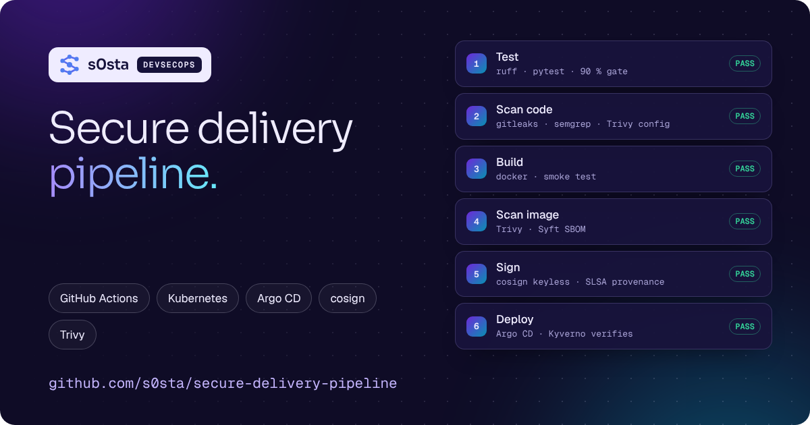
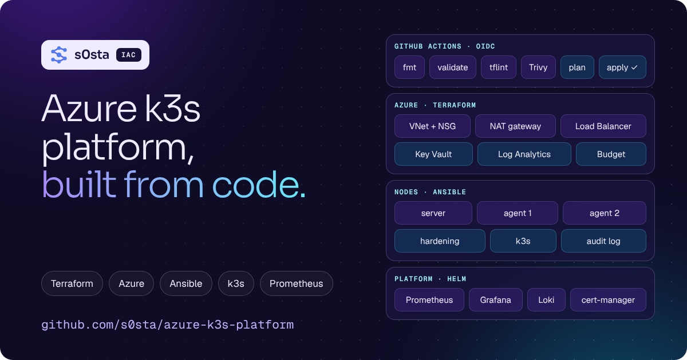

  
  
  
  

## About me

I'm **Hosam Hani**, an **IT Manager** in **Riyadh, Saudi Arabia**, working the **DevSecOps** way: infrastructure as code,
every change through a pipeline, and security checks at every step.

At work I run the complete IT of a sports-brand distributor with **600 people in 9 branches**: Linux and Windows
servers, the network, the ERP, a bilingual online store and security incidents, from the first alert to the final fix.

I automate infrastructure with **Terraform and Ansible**, run workloads on **Kubernetes**, and build CI/CD pipelines that
**scan, sign and verify** everything they ship. I document what I build in an open knowledge base on
[s0sta.com](https://s0sta.com/summary/).

## What I do

<table>
<tr>
<td width="50%" valign="top">

### DevSecOps and cloud

- Infrastructure as Code: Terraform (Azure), Ansible, Packer, cloud-init
- Kubernetes: k3s, Helm, Kustomize, cluster hardening
- CI/CD and GitOps: GitHub Actions, Argo CD
- Supply-chain security: Trivy, Syft SBOM, cosign, Kyverno
- Observability: Prometheus, Grafana, Loki, Fluent Bit

</td>
<td width="50%" valign="top">

### IT operations and security

- Linux and Windows servers, backups and restore tests
- Networks: LAN and Wi-Fi, VLANs, firewalls, VPN, DNS and SSL
- Hardening: SSH, SELinux, auditd, fail2ban, patching
- Incident response: investigation, cleanup and prevention
- ERP (ERPNext, Odoo, Daftara) and e-commerce operations

</td>
</tr>
</table>

## Featured projects

<table>
<tr>
<td width="42%" valign="top"></td>
<td valign="top">

### [Secure delivery pipeline](https://github.com/s0sta/secure-delivery-pipeline)

A Python API delivered the DevSecOps way: tested and scanned on every change, built once, **signed with cosign**,
given an **SBOM and SLSA provenance**, deployed by **Argo CD**, and the cluster only runs images signed by this pipeline.

`GitHub Actions` · `Trivy` · `semgrep` · `gitleaks` · `Kustomize` · `Argo CD` · `Kyverno`

</td>
</tr>
<tr>
<td width="42%" valign="top"></td>
<td valign="top">

### [Azure k3s platform](https://github.com/s0sta/azure-k3s-platform)

A production-style Kubernetes platform on Azure, built only from code: **Terraform** (network, VMs, Key Vault, Azure
Monitor), **Ansible** (hardening and k3s), **Prometheus, Grafana and Loki**. Plan on pull request, apply after approval,
nightly drift check — logged in to Azure with **OIDC, no secrets**.

`Terraform` · `Azure` · `Ansible` · `k3s` · `Helm` · `Prometheus` · `Grafana`

</td>
</tr>
<tr>
<td width="42%" valign="top"></td>
<td valign="top">

### [IT business apps](https://github.com/s0sta/IT-Profile)

Three ready-to-use web apps for companies: **Daem** (IT help desk), **Idara** (manager workspace) and **Sanad**
(field service). Plain PHP 8, a simple web installer, in English, Deutsch and العربية.

`no frameworks` · `SQLite or MySQL` · `prepared statements, CSRF, audit log`

</td>
</tr>
</table>

**DevSecOps knowledge base:** [summaries](https://s0sta.com/summary/) · [commands](https://s0sta.com/commands/) ·
[labs](https://s0sta.com/labs/) · notes: [IT](https://github.com/s0sta/it-notes) and [DevSecOps](https://github.com/s0sta/devsecops-notes)

**Web3 security:** 28 Solidity protocols with 914 tests, live dApps, audit findings and a DeFi exploit archive —
on their own site: **[web3.s0sta.com](https://web3.s0sta.com)**

**Websites I build and run:** [babolatksa.com](https://babolatksa.com) (bilingual WooCommerce store) ·
[here2grow.edu.sa](https://here2grow.edu.sa) (WordPress and SEO for an international school) · [s0sta.com](https://s0sta.com) (self-hosted)

## Experience

| Role | Company | Years |
|:--|:--|:--|
| **IT Manager** | Raed Sports · Riyadh, Saudi Arabia | 2025 – today |
| **Freelance IT & Web Developer** | Remote | 2023 – 2025 |
| **IT Support Specialist** | Farma Care Hospital · Cairo, Egypt | 2021 – 2023 |
| **IT Support** | MedCare Hospital · Sharqia, Egypt | 2020 – 2021 |

## Skills and tools

  
  
  
  
  
  
  
  
  
  
  
  
  
  
  
  
  
  
  

| Area | Skills |
|:--|:--|
| **Cloud and IaC** | Azure (VNet, NSG, VMs, AKS, Key Vault, Monitor), Terraform, Ansible, Packer, cloud-init |
| **Containers and Kubernetes** | Docker, Podman, k3s, kubectl, Helm, Kustomize, Pod Security, NetworkPolicies |
| **CI/CD and supply chain** | GitHub Actions, Argo CD, Trivy, Syft, cosign, Kyverno, gitleaks, semgrep |
| **Observability** | Prometheus, Alertmanager, Grafana, Loki, Fluent Bit |
| **Servers and networking** | RHEL, Ubuntu, Debian, Windows Server, Nginx, Apache, VLANs, firewalls, VPN, DNS, SSL / TLS |
| **Security** | Hardening (SSH, SELinux, auditd), incident response, access control, patching, backup and recovery |
| **Business systems** | ERPNext / Frappe, Odoo, Daftara, WordPress, WooCommerce |
| **Code** | Python, Bash, PHP, SQL, YAML, Git |

## Certifications

| Certificate | Issuer | Date |
|:--|:--|:--|
| Google IT Support Professional Certificate | Google · Coursera | Feb 2025 |
| Ethical Hacker | Cisco Networking Academy | Nov 2024 |
| Operating Systems Basics | Cisco Networking Academy | Nov 2024 |
| Linux Essentials | Cisco Networking Academy · NDG | Oct 2024 |
| Responsive Web Design | freeCodeCamp | Oct 2024 |

**Languages:** Arabic (native) · English (advanced) · German (A1, learning)

## Work with me

- **IT management, servers, cloud and CI/CD** → [contact me on s0sta.com](https://s0sta.com/#contact)
- **Smart-contract audit or Web3 project** → [web3.s0sta.com](https://web3.s0sta.com/audits/)

Riyadh, Saudi Arabia · <a href="https://s0sta.com">s0sta.com</a>

